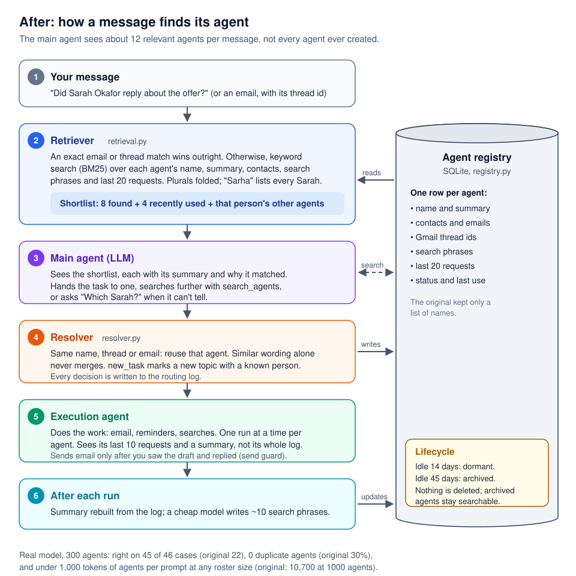
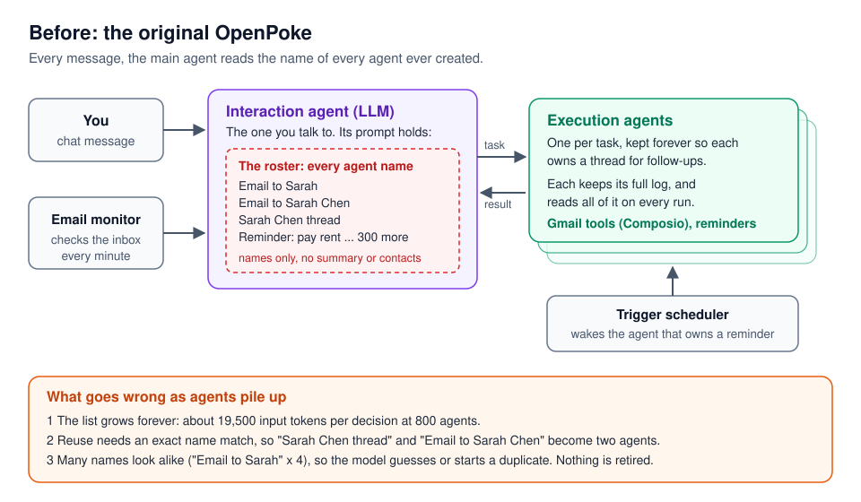
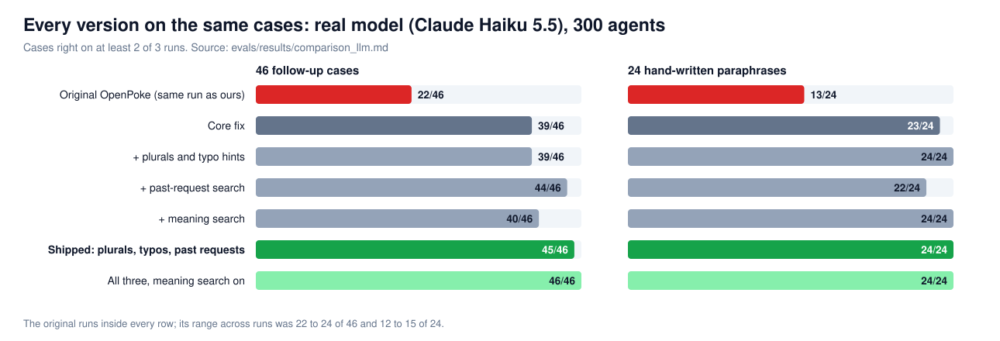

# OpenPoke: fixing agent overload

This is a fork of [OpenPoke](https://github.com/shlokkhemani/openpoke) by Shlok Khemani, an open source take on the Poke assistant. I changed how the main agent finds and reuses its helper agents, so it keeps routing to the right one as helpers pile up. There are tests, an evaluator that runs the original code and this version on the same data, and a live demo that runs them side by side.

The original is on branch `upstream-main` (upstream commit `5b5f635`). Run-by-run detail is in [docs/EVALUATION.md](docs/EVALUATION.md), and the approaches I measured against each other are in [docs/COMPARISON.md](docs/COMPARISON.md).

## In short

**The problem.** OpenPoke has one interaction agent (the one you talk to) and many execution agents, one per task, like "Email to Sarah". Agents are kept forever so they can own a thread for follow-ups. After a few weeks there are hundreds. The original puts every agent's name into every prompt, and reuses an agent only on an exact name match. With four contacts called Sarah and names like "Email to Sarah", the model can't tell which thread a follow-up belongs to. So it guesses, or creates a duplicate.

**The fix.** Treat "which agent is this about?" as a retrieval problem. An SQLite registry keeps a summary, contacts, thread ids, past requests and status for each agent. Each turn the prompt shows a fixed shortlist of 12 (8 found for the message, 4 recently used), plus the other agents of any person the message names. An exact email or thread match always wins. A resolver stops duplicates when an agent is created, and idle agents are retired but stay searchable.

[](docs/architecture.svg)

**Built in two steps.** First the core fix: the registry, the shortlist, exact matches, the duplicate check and the rest of changes 1 to 14 in [What I changed](#what-i-changed), kept on branch `baseline`. On its own it took the original from 22 to 39 of 46 cases right and cut duplicate agents from about 30% to 13%. Then I tried three additions on top of it, each on its own branch, measured each on the same cases, and kept the two that helped: 45 of 46 and no duplicates. See [Alternatives I measured](#alternatives-i-measured).

Click any diagram or chart to open it full size. The original's design is drawn under [What was wrong in the original](#what-was-wrong-in-the-original).

**The result.** Claude Haiku 5.5, 300 agents, the same cases and the same day for both columns, 3 runs per case:

| | Original | This branch |
|---|---|---|
| 46 follow-up cases (40 usual + 6 about a request made mid-history): cases right | 22/46 (34% to 62%) | **45/46** (89% to 100%) |
| same, runs right / right on all 3 runs | 49.3% / 45.7% | **97.8% / 95.7%** |
| same, duplicate agent created when the right one existed | 29.8% | **0%** |
| 24 hand-written paraphrases (no shared words with their agent): cases right | 13/24 | **24/24** |
| same, right on all 3 runs | 45.8% | **100%** |
| Input tokens per routing decision | 9,853 | **7,483** |

Cases right means right on at least 2 of 3 runs; the ranges are 95% Wilson intervals. On the 46 cases this branch fixed 23 and broke 0 against the original (McNemar's exact test, p = 2e-7), and on the paraphrases 11 and 0 (p = 0.001).

As the roster grows:

| | Original | This branch |
|---|---|---|
| Real model, **800 agents**, 40 cases: runs right (core fix, before the additions below) | 54.2% | **100%** |
| 800 agents: duplicate agent created when the right one existed | 44.8% | **0%** |
| 800 agents: input tokens per routing decision | 19,471 | **7,287** |
| Simulated router, **1000 agents**, 197 cases: right | 103/197 | **181/197** |
| 1000 agents: tokens of agent list in each prompt | 10,709 | **999** |

[](docs/charts/roster_growth.svg)

"Core fix" is changes 1 to 13, measured at 50, 300 and 800 agents; the dashed line adds search phrases (change 14), measured at 300 and 800. From `evals/results/llm_results_anthropic-claude-haiku-5-5*.md`.

The data is synthetic. Read [Limitations](#limitations) before quoting any of this.

## What was wrong in the original

[](docs/architecture_original.svg)

1. **The roster is only names.** `roster.py` stored a JSON list of strings: no summary, contacts, timestamps or status.
2. **Every name goes into every prompt.** The prompt grows forever, and most entries look alike.
3. **Reuse needs an exact string match.** "Email to Sarah Chen" and "Sarah Chen thread" become two agents, and the thread's context splits.
4. **Nothing is retired.** The only cleanup is `clear()`, which deletes everything.
5. **Each agent's own history is unbounded.** An execution agent got its whole log on every run.
6. **Agents could share a history.** Log files were named by a slug, so "Email to Sarah" and "email to sarah" read and wrote the same file.
7. **The same agent could run twice at once**, for example a reminder firing while you're talking to it. Both runs read the same history and both could act.

The author names the first problems himself in his [explainer](https://www.shloked.com/writing/openpoke).

## What I changed

| # | Change | Where |
|---|---|---|
| 1 | SQLite agent registry: summary, entities (emails, thread ids, people, subjects), times, run count, status. `roster.json` is migrated once, not deleted | `registry.py`, `roster.py` |
| 2 | Fixed shortlist per turn: 8 retrieved + 4 most recently used, each with status, last use, summary and why it matched | `retrieval.py`, `interaction_agent/agent.py` |
| 3 | Ranking: an exact email or thread match first, BM25 keyword search within that, status and recency only break ties | `retrieval.py` |
| 4 | `search_agents` tool, so the model can look past the shortlist, including retired agents | `interaction_agent/tools.py` |
| 5 | Dedup on create: reuse on the same name, thread, email or normalised name. Similar wording alone never merges. A `new_task` flag for "something new with a known contact" | `resolver.py` |
| 6 | Profiles rebuilt from the agent's log after each run | `digest.py` |
| 7 | Lifecycle: dormant after 14 idle days, archived after 45, never while it owns a live reminder. Nothing is deleted | `lifecycle.py` |
| 8 | Routing log: every decision with its reason and look-alikes | `routing.py` |
| 9 | Execution agents see their last 10 requests plus a summary | `execution_agent/` |
| 10 | Stable agent ids, so different names never share a log file | `ids.py` |
| 11 | One run at a time per agent, shared by chat and the reminder scheduler | `batch_manager.py` |
| 12 | When the message names a person, list that person's other agents by name and topic | `retrieval.py` |
| 13 | Prompt: search for the name a task was probably filed under, not the user's words | `system_prompt.md` |
| 14 | Search phrases: after an agent's first run, a cheap model writes about 10 ways a user might refer to it, and search indexes them | `phrases.py` |
| 15 | Plurals folded in search and in the dedup key, so "groceries" finds "Grocery list" | `entities.py` |
| 16 | A misspelt contact name ("Sarha") gets a hint listing every Sarah, and the model asks which one | `retrieval.py`, `system_prompt.md` |
| 17 | Search also reads each agent's last 20 requests, at half weight, so "did the seating chart come through?" finds the agent it was asked of | `retrieval.py` |
| 18 | Optional search by meaning with a small local model, off by default | `embeddings.py` |

Changes 12 to 17 were each added after an eval showed a gap. The tests that pin the routing behaviour are `test_retrieval.py`, `test_resolver.py`, `test_registry.py`, `test_lifecycle.py` and `test_outbound_guard.py`.

## What the live demo showed

`tools/demo.py` loads the same 300 synthetic agents into the apps and sends each the same message (see [Running it](#running-it)). Both apps ran on Haiku 5.5. Gmail wasn't connected, so neither app could send anything, but which agent each one picked is real. Among the 300 agents are four Sarahs: Okafor (job offer), Murphy (tax documents), Dubois and Evans.

| You type | Original | This branch |
|---|---|---|
| "Could you send the updated grocery to **Sarah**" | Went straight to "Email to Sarah", which is **Sarah Murphy's** tax agent | Asked "Which Sarah? Okafor, Dubois, Evans or Murphy?" |
| "**Sarah Okafor**" | Stayed on Murphy's agent. It couldn't find Okafor's address, and its draft left out one of the three items | Created "Grocery list email to Sarah Okafor" with her right address and all three items |
| "message sarah regarding the movie..." | Murphy's agent again, without asking | Asked which Sarah |

For the movie message, the original made 6 model calls with 70,233 input tokens ($0.0078, 17.1 s). This branch made 1 call with 10,760 tokens ($0.0013, 8.6 s). Most of that gap is because it asked instead of doing the wrong work, so it isn't a like-for-like saving.

In a second live run, 10 labelled messages (one per category) went to the original and to each version at once. The original got 5 right, the core fix 8, and all three additions together 10. Ten messages is an illustration, not evidence: the intervals overlap.

## Design choices

**One agent per task, not one per person.** The explainer's example has one agent own everything about Alice. I kept the original's per-task agents and added `new_task`, because the original prompt already says to start a new agent when tasks can run in parallel, and with the run lock one agent per person would make Emma's new audit email wait behind her lease work. The cost is more agents, which retrieval and lifecycle have to carry.

**Hard matches before similarity.** An email address or Gmail thread id says which thread a message belongs to. Keyword or meaning similarity only says what it's about. So exact matches decide, similarity only ranks, and similarity never merges two agents.

**SQLite and in-process BM25, not Elasticsearch or a vector database.** One user has hundreds of agents, maybe a few thousand. The registry needs exact lookups ("who owns this thread?") and safe writes. SQLite does both and ships with Python. Routing work takes about 39 ms per turn at 300 agents and 156 ms at 1000, against about 3 seconds for one model call. Elasticsearch would need Docker and 1 to 4 GB of memory on a laptop, and it ranks with BM25 too. A search server makes sense with many users on one deployment.

**Meaning search is measured, but off by default.** It needs a 110 MB model. With it on, the right agent is in the prompt for all 24 paraphrases (95.8% without it), and the one case below is fixed. Turn it on with `OPENPOKE_AGENT_RETRIEVER=hybrid` where the download is fine.

## Alternatives I measured

The additions (changes 15 to 18) were each built on their own branch first, then measured on the same cases, model and seed (`python -m evals.compare_llm`). Real model, 46 follow-up cases:

| Version | Cases right | 6 mid-history cases | Paraphrases right | Duplicates | Fixed / broke vs core fix |
|---|---|---|---|---|---|
| Core fix (changes 1 to 14) | 39/46 | 0/6 | 23/24 | 13.2% | |
| + plurals and typo hints | 39/46 | 0/6 | 24/24 | 13.2% | 0 / 0 |
| + past-request search | 44/46 | 6/6 | 22/24 | 0% | 6 / 1 |
| + meaning search | 40/46 | 0/6 | 24/24 | 14.0% | 1 / 0 |
| **This branch: plurals, typos and past requests** | **45/46** | **6/6** | **24/24** | **0%** | **7 / 1** (p = 0.07) |
| All of them, meaning search on | 46/46 | 6/6 | 24/24 | 0% | 7 / 0 (p = 0.016) |

[](docs/charts/alternatives.svg)

The core fix and single-addition rows ran on 2026-10-28, and this branch's row on 2026-10-29. The original runs inside every row, and its range across those runs (22 to 24 of 46) shows how much identical runs vary.

**The one break.** "Write to Ibrahim Holloway about the launch timeline" should create a new agent. Past-request search puts 10 "launch timeline" agents next to another Ibrahim, and the model asked a question instead of acting in 2 of 3 runs. It never picked a wrong agent. The same case broke with past-request search alone, so I count it as a real cost, not noise.

**Why not ship all three, when that row got everything right?** Meaning search needs an extra package and a 110 MB model, so every fresh install, a reviewer's included, would have to download it before the default works, and it adds 50 to 80 ms per message. On these tests it bought one case, and that case fails safely without it: the model asks instead of acting. So the default stays light, and the best result is one setting away (`OPENPOKE_AGENT_RETRIEVER=hybrid` after `pip install -r server/requirements-embeddings.txt`).

Branch map: `baseline` is the core fix alone, frozen. `fix-plurals-typos`, `approach-past-requests` and `approach-embeddings` hold each addition on its own with its write-up. `all-approaches` is where they were compared.

## Other gaps I found

Fixed:
- **The server didn't start on Windows.** `roster.py` imported `fcntl`, which is Unix only.
- **The default model no longer existed.** `anthropic/claude-sonnet-4` is retired on OpenRouter, so a fresh install failed on the first message. The default is now `anthropic/claude-sonnet-5.5`, and each role has its own env var.
- **Send confirmation was a prompt instruction, not a rule.** Execution agents read inbound email and can reply or forward, so one injected line in an email only had to convince one model. `services/safety/outbound.py` now blocks a send unless every recipient was in a draft the user saw and answered. It can't judge whether the reply meant yes.
- **No record of routing decisions.** There's now a JSONL log, which is how bad decisions can become eval cases.

Not fixed, worth knowing:
- Gmail tools aren't scoped per agent, so any agent can act on any thread.
- All results from one batch wait for the slowest agent (up to 90 s) before the user hears anything.

## Limitations

- **The data is synthetic.** A script generated the agents and most test messages, built around known failure modes. The 24 paraphrases were written separately, with Claude, so they don't reuse the script's wording. Neither comes from real users, who will be messier.
- **One model family does most of the work.** Haiku routes, Haiku writes the search phrases, and the paraphrases were written with Claude, which is the same family and could make them easier for it. Gemma 4 checked the core fix's routing only (29/40 against 19/40 for the original).
- **The sample is small.** 46 cases and 24 paraphrases. The difference from the original is large and significant. The difference from the core fix (7 fixed, 1 broken) is not significant on its own.
- **The suite is now nearly saturated.** At 45/46 and 24/24 it catches regressions, but it can't show further gains. Harder cases are the next step.
- **It asks "which Sarah?" even right after you named one.** That's a deliberate lean towards asking before an email goes out, but a person would guess the Sarah from the last turn.
- **Typo matching is simple.** It catches one-letter typos in a name position that keep the first letter (all 124 in a labelled check, with no hint on any of 301 eval messages). 3 of 36 common names no contact has ("Sara", "Nora", "Rose") also get a "did you mean".
- **Gmail isn't tested end to end.** Agreed with General Magic: routing never needs Gmail, so none of the numbers above depend on it. Incoming-email routing by thread id, drafting and the send guard are unit-tested with fakes.
- **It isn't faster for the user.** The final answer arrives 11 to 16 seconds after a message, as with the original. See next steps.

## Next steps

1. **Speed.** The main agent makes about 4 model calls per message, and 2 of them do nothing: the loop asks the model "anything else?" after a step that already ends the turn. Ending the loop there saves about 40% of its tokens. Half of its output is thinking; turning that off could cut 2 to 3 seconds, but needs the routing eval rerun. Prompt caching would cut cost more than time.
2. **Real traffic.** Turn routing-log mistakes into eval cases, and add harder cases now that the suite is nearly saturated.
3. **A second model family** for writing test cases, to rule out same-family bias.
4. **Recent context for first names:** prefer the Sarah from the last few turns, but still ask before sending.
5. **A merge tool** for duplicates that already exist.

## Running it

```bash
pip install -r server/requirements.txt pytest
python -m pytest                                  # all tests, about two minutes, no keys needed
python -m evals.run_eval                          # simulated eval, about 2 minutes, free, writes evals/results/
python -m evals.compare                           # every version side by side, simulated, about 12 minutes, free
python -m evals.run_eval --router llm --phrases   # real model, needs OPENROUTER_API_KEY in .env, about $0.30 on Haiku 5.5
python -m evals.run_eval --set paraphrase --router llm --phrases   # the 24 hand-written paraphrases
python -m evals.compare_llm --reuse               # rebuild the real-model comparison from the saved runs, no calls
```

The real-model eval uses `anthropic/claude-haiku-5.5` unless you pass `--model`. More options are in [docs/EVALUATION.md](docs/EVALUATION.md). Meaning search needs `pip install -r server/requirements-embeddings.txt`; without it the tests that need the model are skipped.

### Live demo: side by side

```bash
git worktree add ../openpoke-original 5b5f635   # the original (branch upstream-main), in its own folder
python tools/demo.py seed                       # the same 300 agents into both apps (moves existing data aside)
python tools/run_mine.py                        # this branch on port 8001, in its own terminal
python tools/run_original.py                    # the original on port 8002, in another terminal
python tools/demo.py ask "Could you send the updated grocery to Sarah"
python tools/demo.py status
```

`ask` prints, for each app, its replies, which agent it used (and for this branch why), how many agents were in its prompt, and its model calls, tokens, cost and time. For a labelled eval case it also prints the right answer. `run_original.py` runs the original's code unchanged, with two runtime-only patches it needs to start today: a stand-in for `fcntl` on Windows, and a current model name. Both apps run on Haiku 5.5, and a message costs under a cent per app.

To compare every version at once, each as its own app with its own port and data folder:

```bash
python tools/demo.py --variants every seed       # the original plus main, plurals_typos, past_requests, embeddings, default, all
python tools/run_mine.py --variant default       # one terminal per version, ports 8011 to 8016
python tools/demo.py --variants every cases      # one labelled case per category (10), then a score per app
```

`--variants main,default` runs just those two. Each message costs about a cent per app.

### New settings (env vars, all optional)

| Variable | Default | What it does |
|---|---|---|
| `OPENPOKE_AGENT_SHORTLIST` / `OPENPOKE_AGENT_RECENT` | 8 / 4 | Agents retrieved / recently used per turn |
| `OPENPOKE_AGENT_SUMMARY_CHARS` | 200 | Summary length shown per agent |
| `OPENPOKE_AGENT_NAMED_PEOPLE` | 12 | A named person's other agents listed (0 = off) |
| `OPENPOKE_AGENT_PHRASES` / `OPENPOKE_PHRASES_MODEL` | 1 / `anthropic/claude-haiku-5.5` | Search phrases after an agent's first run (0 = off) |
| `OPENPOKE_FOLD_PLURALS` | 1 | Fold plurals in search (0 = off) |
| `OPENPOKE_AGENT_NAME_HINTS` | 1 | "Did you mean ...?" hints for misspelt contact names (0 = off) |
| `OPENPOKE_AGENT_INDEX_REQUESTS` | 1 | Search each agent's last 20 requests at half weight (0 = off) |
| `OPENPOKE_AGENT_RETRIEVER` | bm25 | `hybrid` adds search by meaning (needs the embeddings install) |
| `OPENPOKE_EMBEDDING_MODEL` / `OPENPOKE_EMBEDDING_CACHE` | `BAAI/bge-small-en-v1.5` / fastembed's default | Embedding model and where its files go |
| `OPENPOKE_AGENT_DORMANT_DAYS` / `OPENPOKE_AGENT_ARCHIVE_DAYS` | 14 / 45 | Idle days before demotion |
| `OPENPOKE_EXECUTION_HISTORY_LIMIT` | 10 | Past requests an execution agent sees (0 = all) |
| `OPENPOKE_OUTBOUND_GUARD` | enforce | `off` disables the send guard |
| `OPENPOKE_DATA_DIR` | `server/data` | Where the app keeps its data (the demo runs several copies) |
| `OPENPOKE_INTERACTION_MODEL`, `_EXECUTION_MODEL`, `_SEARCH_MODEL`, `_SUMMARIZER_MODEL`, `_CLASSIFIER_MODEL` | `anthropic/claude-sonnet-5.5` | Model per role |

### What's new in the repo

```
server/services/execution/   registry, ids, entities, retrieval, resolver, phrases, digest, lifecycle, routing, roster (migration), embeddings
server/agents/execution_agent/batch_manager.py   per-agent run lock
server/services/safety/outbound.py               send confirmation guard
evals/     scenario generator, hand-written paraphrase set, copy of the original, harness, stats, real-model mode, compare, typo check, results/
tests/     unit and behaviour tests
tools/     run_original.py, run_mine.py, demo.py, usage_meter.py
docs/      EVALUATION.md, COMPARISON.md, APPROACH_PAST_REQUESTS.md, APPROACH_EMBEDDINGS.md
```

---

## Original OpenPoke setup

OpenPoke is a simplified, open source take on [Interaction Company's](https://interaction.co/about) [Poke](https://poke.com/) assistant. It covers email triage, reminders and persistent agents, with a FastAPI backend, models through [OpenRouter](https://openrouter.ai/), Gmail through [Composio](https://composio.dev/), and a Next.js web UI.

Requirements: Python 3.10+, Node.js 18+, npm 9+.

1. Copy `.env.example` to `.env`, then add an OpenRouter API key, a Composio API key and your Gmail auth config id.
2. Create and activate a virtualenv, then run `pip install -r server/requirements.txt`.
3. Run `npm install --prefix web`.
4. Start the server: `python -m server.server --reload`.
5. In a second terminal, start the web app: `npm run dev --prefix web`.
6. Open http://localhost:3000, go to Settings → Gmail and complete the Composio OAuth flow.

Runtime data lives in `server/data/`, which git ignores.

## License

MIT, same as the original. See [LICENSE](LICENSE).
